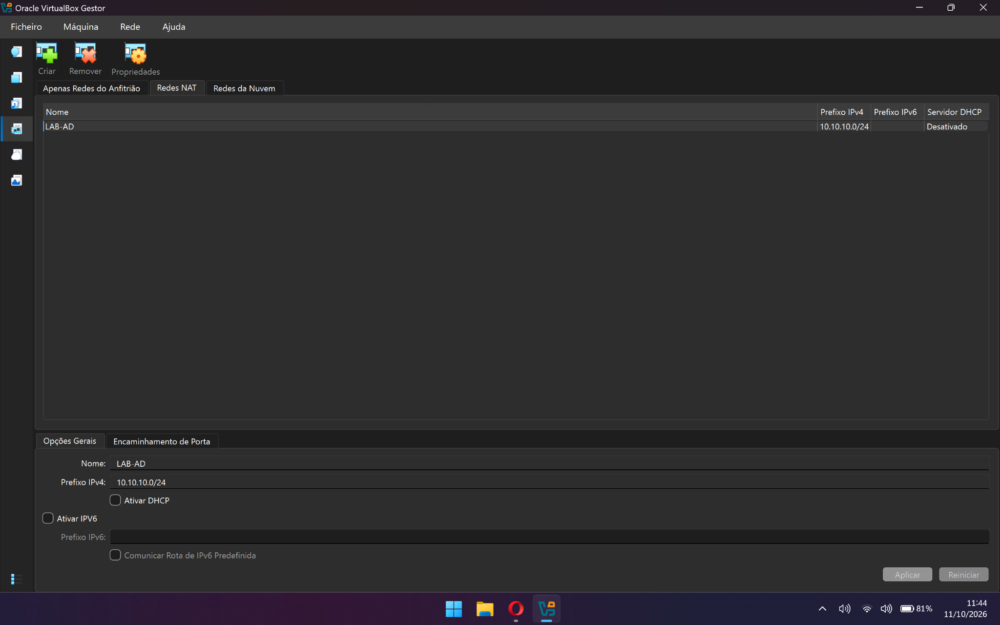
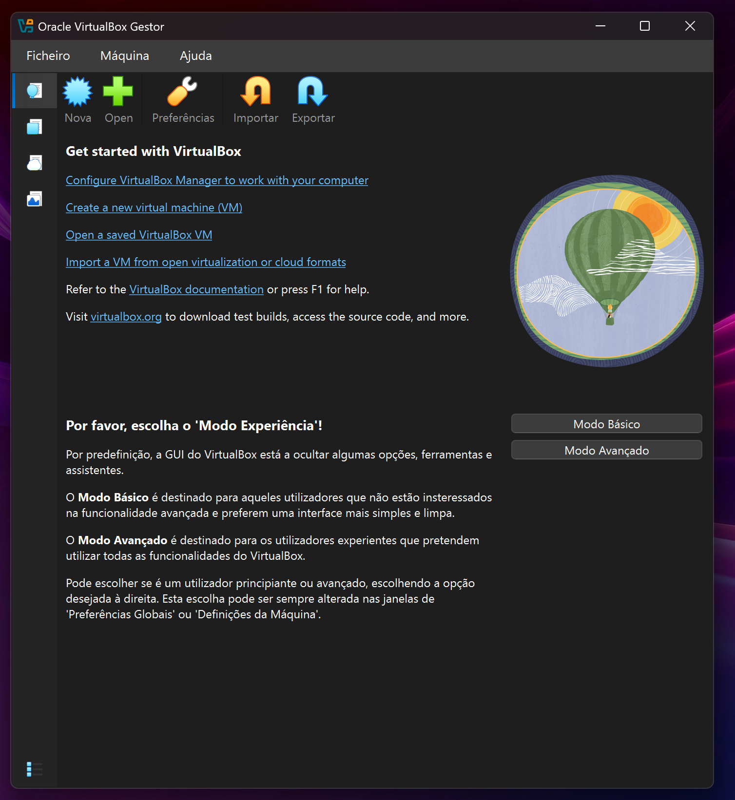
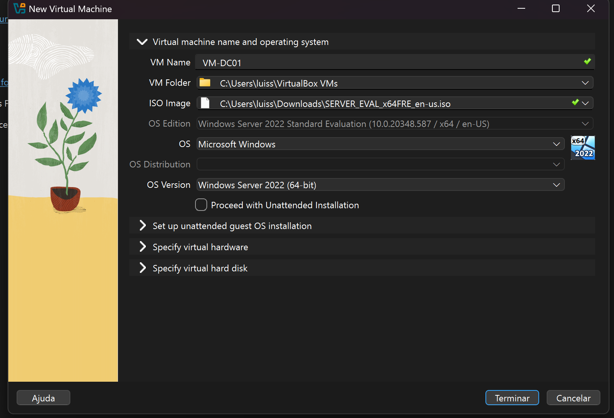
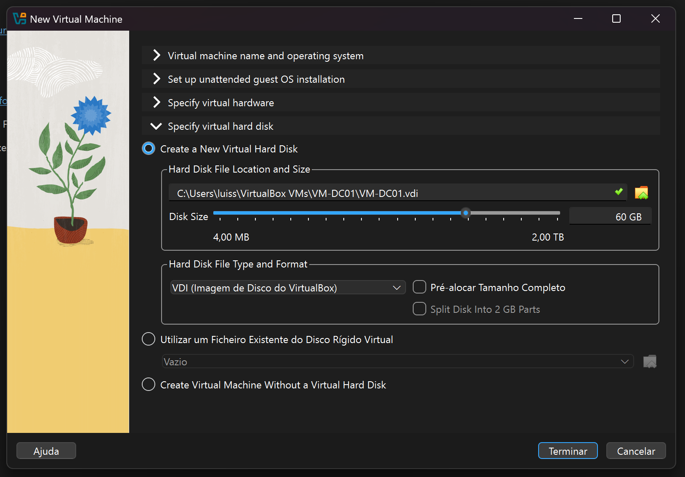
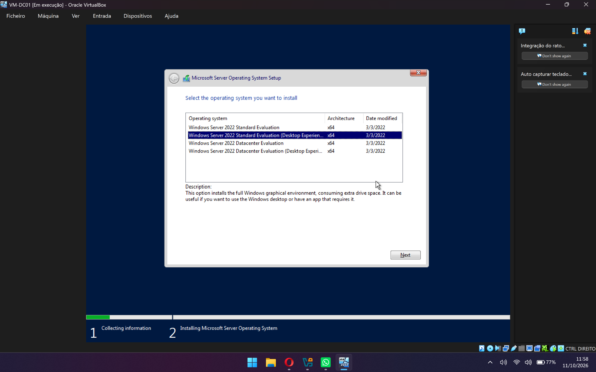
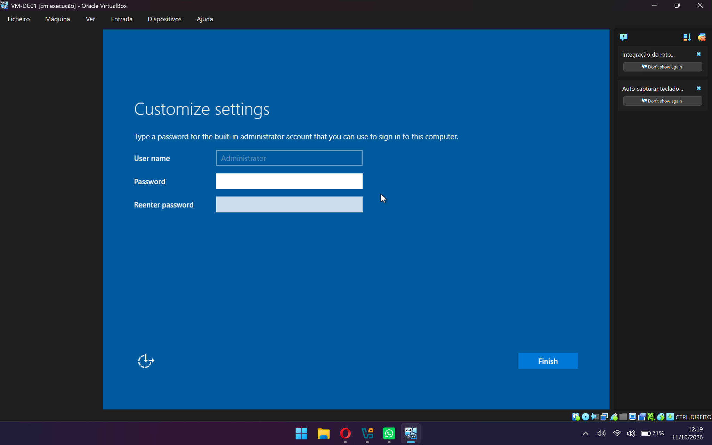
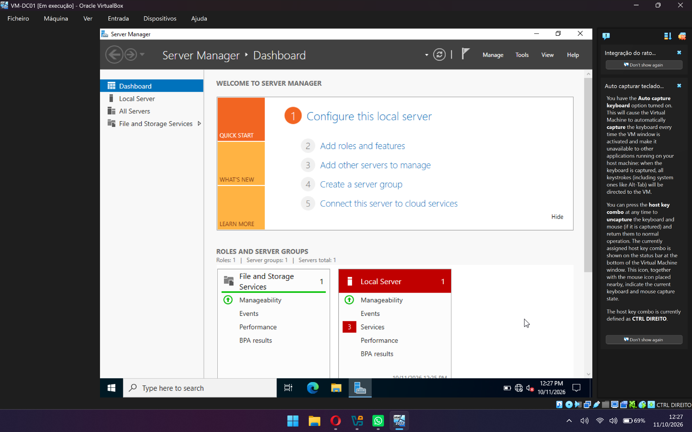

# Lab 1 — Lab Environment Setup

**English** | [Português](laboratorio-01.md)

## 1. Objective

In this lab, I set up a virtualization environment to work with Windows Server 2022. The goal was to create two virtual machines, place them on the same virtual network, configure static IPv4 addresses, and confirm that the servers can communicate with each other and reach external services.

Promoting a server to Domain Controller and creating the forest, tree and domain are part of Lab 2.

## 2. Technologies used

- Oracle VirtualBox
- Windows Server 2022 Standard Evaluation
- VirtualBox NAT Network
- IPv4
- Windows PowerShell

## 3. Virtual network configuration

In VirtualBox, I created the NAT Network `LAB-AD`. I chose a network dedicated to the lab so the virtual machines could communicate with each other and access the Internet without being connected directly to the physical network. DHCP was disabled because the servers' IPv4 addresses were configured manually.

| Parameter | Configuration |
|---|---|
| Network name | `LAB-AD` |
| Type | NAT Network |
| IPv4 prefix | `10.10.10.0/24` |
| DHCP | Disabled |
| IPv6 | Disabled |

**Evidence:**



## 4. First server — DC01

### 4.1. Creating the virtual machine

I created the `VM-DC01` virtual machine in VirtualBox and attached the Windows Server 2022 ISO to it. The installation was done manually, without the unattended installation option, in order to go through each step of the setup wizard.

| Parameter | Configuration |
|---|---|
| Virtual machine name | `VM-DC01` |
| Operating system | Windows Server 2022 Standard Evaluation |
| Interface | Desktop Experience |
| Virtual processors | 2 |
| RAM | 4096 MB |
| Virtual disk | 60 GB |
| Disk format | VDI |
| Disk allocation | Dynamic |
| Network | `LAB-AD` |

**Evidence:**






### 4.2. Installation and first sign-in

During installation, I selected **Windows Server 2022 Standard Evaluation (Desktop Experience)**. This option includes the graphical interface, which is needed to carry out the lab tasks using the Windows Server tools.

I set a password for the local `Administrator` account and, once the installation finished, signed in to the server.

**Evidence:**




### 4.3. Computer name

After installation, I changed the computer name to `DC01`. I confirmed the name with the command:

```powershell
hostname
```

The output was `DC01`.

### 4.4. IPv4 configuration

I configured the `DC01` network adapter with the following values:

| Parameter | Value |
|---|---|
| IPv4 address | `10.10.10.10` |
| Subnet mask | `255.255.255.0` |
| Default gateway | `10.10.10.1` |
| Initial preferred DNS | `1.1.1.1` |
| Initial alternate DNS | `8.8.8.8` |

I used the following command to check the adapter's full configuration:

```powershell
ipconfig /all
```

At this stage, public DNS servers were used to test
